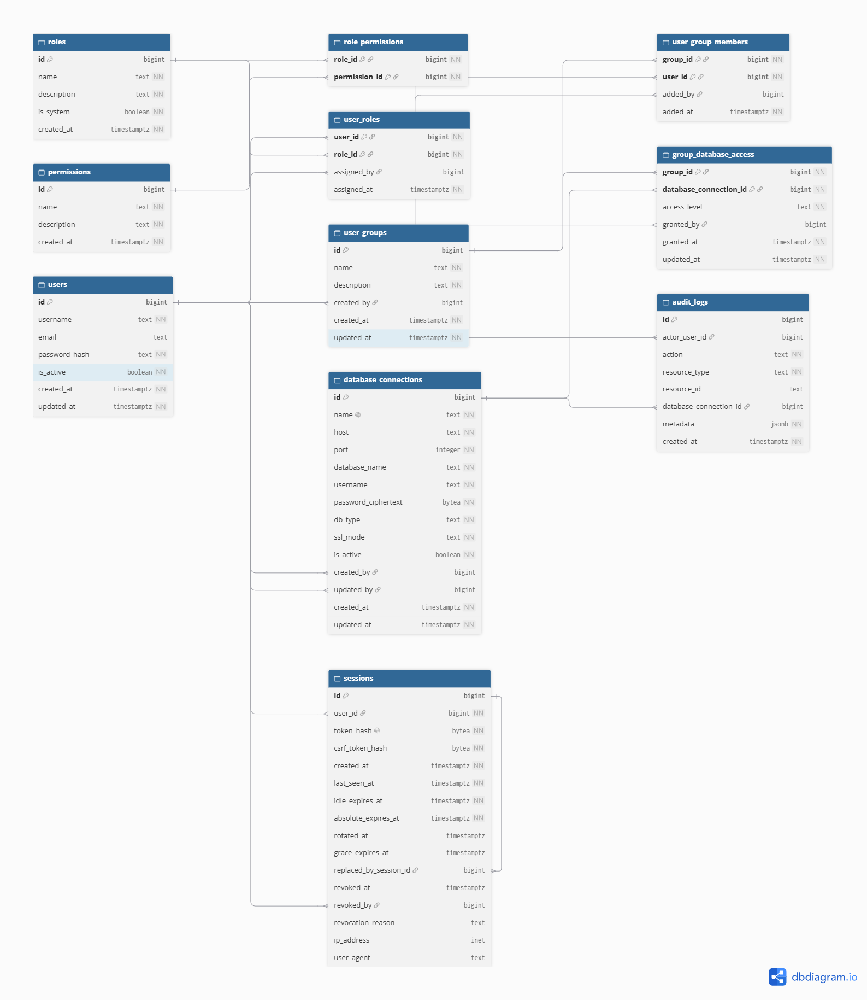

# HarrowDotCom

**Kode Kelompok: K02-11**

Tugas besar IF3110 Pengembangan Aplikasi Web.

## Anggota Kelompok

| NIM | Nama Lengkap |
| --- | --- |
| 13524005 | Geraldo Artemius |
| 13524080 | Renuno Yuqa Frinardi |
| 13524104 | Valentino Daniel Kusumo |

## Struktur Folder

```text
.
├── cmd/
│   ├── server/               # Menjalankan server, mengatur route, middleware, dan handler HTTP.
│   └── seed-admin/           # Program untuk membuat atau memperbarui akun Platform Admin.
├── internal/
│   ├── admin/                # Pengelolaan user, group, pemberian akses, dan audit log.
│   ├── auth/                 # Login, password, session, dan perlindungan CSRF.
│   ├── authz/                # Pemeriksaan hak akses berdasarkan keanggotaan group.
│   ├── explain/              # Menjalankan dan membaca hasil EXPLAIN/ANALYZE.
│   ├── migration/            # Draft SQL, validasi, eksekusi, transaksi, dan riwayat migration.
│   ├── store/                # Akses database, konfigurasi koneksi, enkripsi, dan database viewer.
│   │   ├── migrations/       # SQL untuk menyiapkan tabel internal aplikasi di PostgreSQL.
│   │   └── migrations-mariadb/ # SQL untuk membuat tabel internal aplikasi dalam format MariaDB.
│   └── web/
│       ├── templates.go      # Registrasi dan pemuatan template aplikasi.
│       ├── templates/        # Halaman aplikasi menggunakan Go template.
│       └── static/           # File CSS untuk tampilan aplikasi.
├── test/                     # Pengujian terpisah dari package implementasi.
│   ├── auth/                 # Pengujian autentikasi dan redaksi data sensitif.
│   ├── authz/                # Pengujian permission dan otorisasi.
│   ├── explain/              # Pengujian fitur EXPLAIN/ANALYZE.
│   ├── migration/            # Pengujian validasi, service, store, dan eksekusi migration.
│   └── store/                # Pengujian koneksi dan query database.
├── assets/                   # Aset dokumentasi, termasuk gambar ERD.
├── .env.example             # Contoh konfigurasi environment.
├── docker-compose.yml       # Konfigurasi container PostgreSQL dan MariaDB.
├── go.mod                   # Nama module, versi Go, dan dependency proyek.
├── go.sum                   # Checksum dependency Go.
└── README.md                # Informasi proyek dan cara menjalankannya.
```

Pengujian berada di folder `test/` dan dikelompokkan berdasarkan fitur yang diuji. File
`compat.go` pada beberapa subfolder membantu pengujian tetap kompatibel dengan konfigurasi
database yang digunakan.

## ERD Model Relasional

ERD berikut menunjukkan model relasional database Harrow:



Relasi utamanya adalah:

- `users` menyimpan akun pengguna, sedangkan `sessions` menyimpan sesi login yang terkait dengan setiap user.
- `users` dan `user_groups` terhubung secara many-to-many melalui `user_group_members`.
- `user_groups` dan `database_connections` juga terhubung secara many-to-many melalui `group_database_access`. Tabel ini menyimpan level akses `View` atau `View + Edit`.
- Hak akses aplikasi dikelola melalui `roles`, `permissions`, `role_permissions`, dan `user_roles`.
- `audit_logs` mencatat aktivitas pengguna terhadap resource aplikasi atau koneksi database.

## Cara Menjalankan

Semua perintah berikut dijalankan dari root repository.

### 1. Nyalakan Docker

Buka Docker Desktop atau jalankan Docker Engine, lalu tunggu sampai siap digunakan. Pastikan Docker Compose tersedia.

Siapkan juga Go sesuai versi pada `go.mod` (saat ini `1.27.3`).

### 2. Siapkan konfigurasi environment

Jika belum memiliki `.env`, salin contoh konfigurasi:

```bash
cp .env.example .env
```

Isi password PostgreSQL, password user MariaDB, dan password root MariaDB pada `.env`. Port bawaan untuk akses dari komputer lokal adalah:

| Layanan | Host | Port |
| --- | --- | --- |
| PostgreSQL | localhost | 5433 |
| MariaDB | localhost | 3307 |
| Aplikasi | localhost | 8080 |

Untuk membuat `ENCRYPTION_KEY`, jalankan:

```bash
openssl rand -hex 32
```

Salin hasilnya ke nilai `ENCRYPTION_KEY` di `.env`. Jika sudah ada key yang digunakan untuk menyimpan koneksi, gunakan key tersebut agar password koneksi lama tetap dapat dibuka.

Server membaca koneksi PostgreSQL dari variabel `POSTGRES_*`. Jika `POSTGRES_DATABASE_URL` diisi, nilainya digunakan sebagai pengganti konfigurasi tersebut.

### 3. Jalankan PostgreSQL dan MariaDB sekaligus

```bash
docker compose --profile mariadb up -d --wait postgres mariadb
```

Perintah tersebut menjalankan kedua database dan menunggu sampai keduanya siap. Status container dapat diperiksa dengan:

```bash
docker compose ps
```

Konfigurasi database pada Docker diterapkan saat volume pertama kali dibuat. Jika memakai volume lama, gunakan kredensial yang sesuai dengan database yang sudah ada.

### 4. Buat akun admin pada penggunaan pertama

```bash
go run ./cmd/server seed-admin admin
```

Jika `SEED_ADMIN_PASSWORD` belum diatur, ketik password admin lalu tekan Enter.

### 5. Jalankan server

```bash
go run ./cmd/server
```

Buka [http://localhost:8080](http://localhost:8080), lalu login menggunakan akun yang sudah dibuat. Port server dapat diubah melalui variabel `PORT`.

| Peran atau Akses | Keterangan |
| --- | --- |
| User | Pengguna aplikasi yang memperoleh akses database melalui keanggotaan group. |
| Platform Admin | Mengelola user, group, koneksi database, dan pemberian akses melalui halaman **Groups** serta **Access management**. |
| View + Edit | Dapat melihat schema, data, dan riwayat, serta membuat, mengubah, dan menjalankan migration pada database yang diberikan akses. |
| View (View Only) | Dapat melihat schema, data, serta riwayat dan detail migration tanpa melakukan perubahan. |

## Penyimpanan dan Dukungan Database

PostgreSQL menyimpan data internal aplikasi seperti user, group, konfigurasi koneksi, izin, dan riwayat migration. Database target yang dikelola dapat berupa PostgreSQL atau MariaDB.

Migration MariaDB saat ini mendukung `SELECT`, `INSERT`, `UPDATE`, dan `DELETE`. Gunakan tabel InnoDB agar perubahan data dapat di-rollback. EXPLAIN/ANALYZE MariaDB menerima satu perintah `SELECT`, `UPDATE`, atau `DELETE` setiap kali dijalankan.

## Menghentikan Aplikasi

Tekan `Ctrl+C` pada terminal server, lalu hentikan container dengan:

```bash
docker compose --profile mariadb stop postgres mariadb
```

Data database tetap tersimpan di volume Docker.