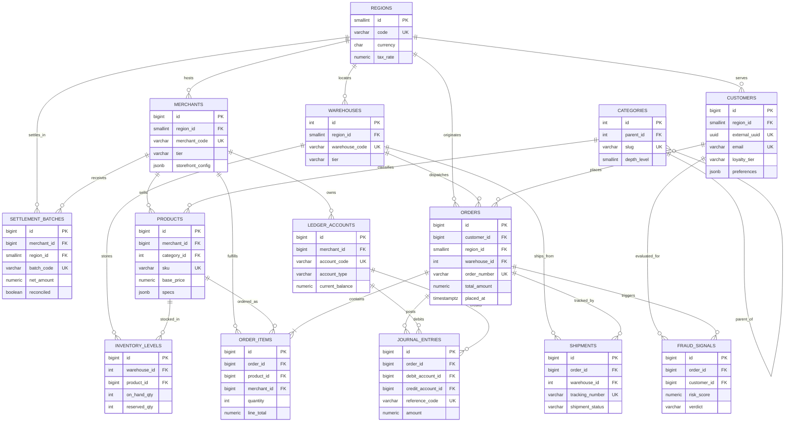
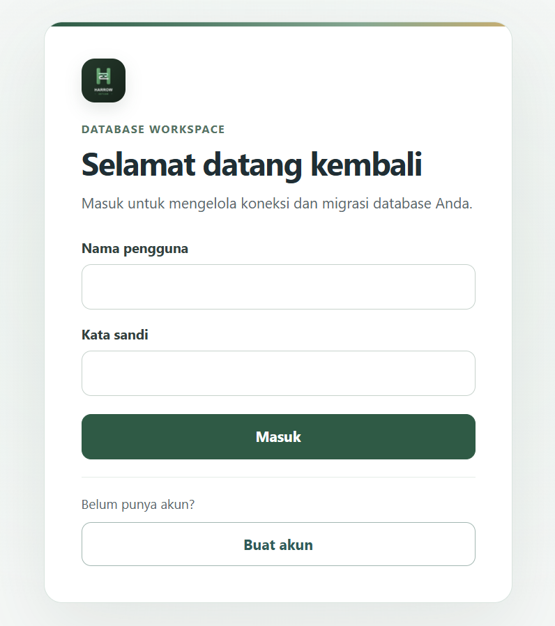
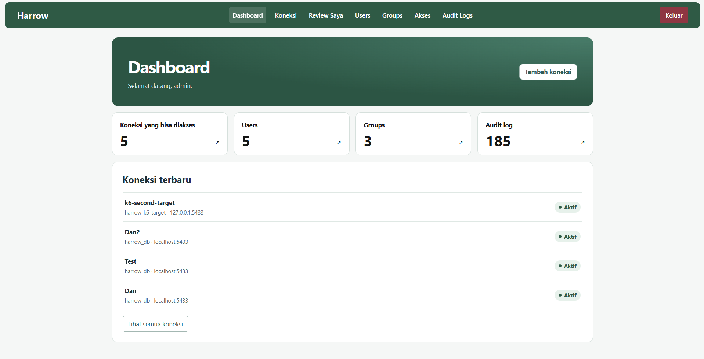
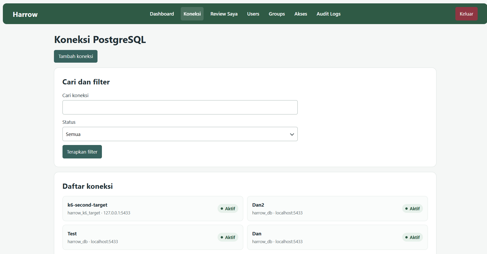
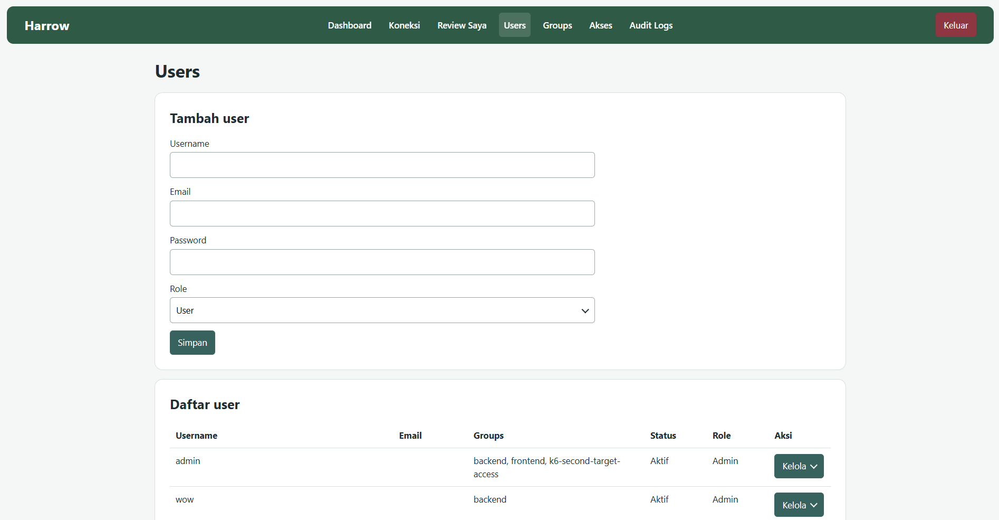
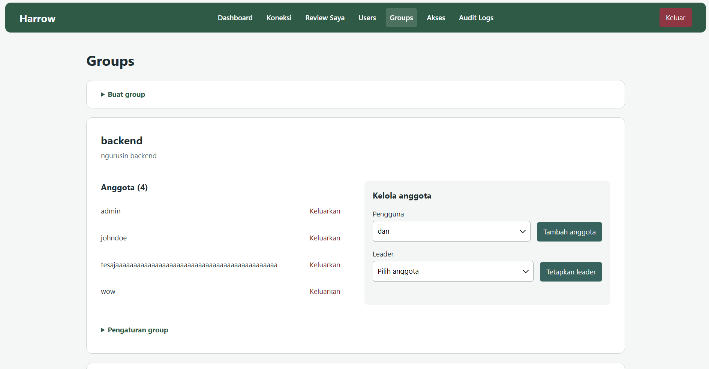
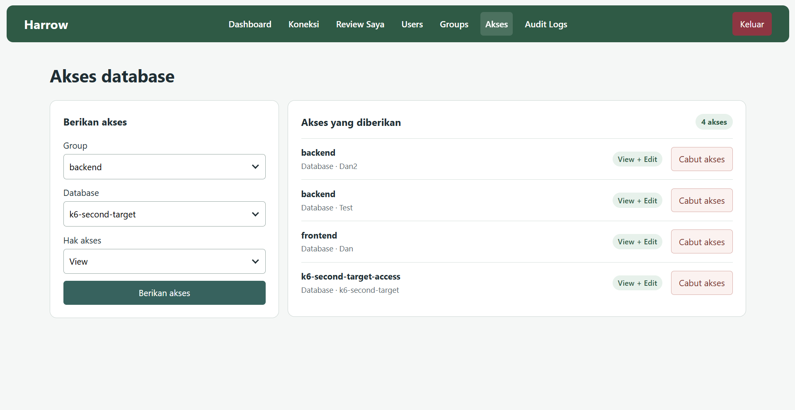
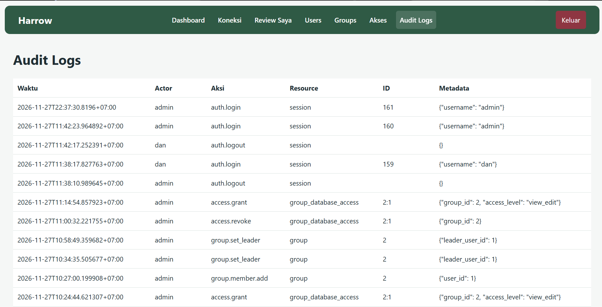

# HarrowDotCom

**Kode Kelompok: K02-11**

**HarrowDotCom** adalah platform manajemen koneksi database, eksplorasi skema/data (*Database Explorer*), analisis rencana eksekusi query (`EXPLAIN` / `EXPLAIN ANALYZE`), serta manajemen dan eksekusi migrasi SQL sinkron maupun asinkron (*normal* & *cursor-based batch mode*) yang dikembangkan untuk Tugas Besar **IF3110 Pengembangan Aplikasi Web**.

### Anggota Kelompok

| NIM | Nama Lengkap |
| --- | --- |
| 13524005 | Geraldo Artemius |
| 13524080 | Renuno Yuqa Frinardi |
| 13524104 | Valentino Daniel Kusumo |

---

## Struktur Folder

```text
.
├── .github/workflows/
│   └── codeql.yml            # Workflow GitHub Actions untuk analisis statis (SAST) CodeQL.
├── assets/                   # Aset gambar dokumentasi.
├── cmd/
│   ├── server/               # HTTP API server, routing, middleware, dan autentikasi/otorisasi.
│   ├── worker/               # Worker asinkron pemroses antrean job migrasi & rollback batch.
│   ├── seed-admin/           # CLI pembuatan/pembaruan akun Platform Admin awal.
│   ├── seed-target-db/       # CLI verifikasi & registrasi otomatis koneksi database commerce-db.
│   └── bench-migration/      # Alat benchmark eksekusi migrasi mode normal vs batch.
├── docs/
│   └── codeql.md             # Dokumentasi cakupan dan bukti hasil pemindaian CodeQL.
├── frontend/                 # Single Page Application React + Vite (dan konfigurasi Nginx).
├── internal/
│   ├── admin/                # Pengelolaan user, group, hak akses database, dan audit log.
│   ├── async/                # Async engine: antrean PostgreSQL, lease lock, retry, batch executor.
│   ├── auth/                 # Login, hashing password, manajemen sesi, dan proteksi CSRF.
│   ├── authz/                # Otorisasi berbasis role dan keanggotaan group.
│   ├── explain/              # Eksekusi dan pembacaan hasil EXPLAIN / EXPLAIN ANALYZE.
│   ├── migration/            # Validasi SQL, workflow approval, revisi, dan eksekusi migrasi.
│   ├── store/                # Koneksi database, enkripsi AES-GCM, migrasi internal, dan explorer.
│   ├── telemetry/            # Structured JSON logger, OpenTelemetry tracing, dan redaksi rahasia.
│   └── web/                  # Template halaman dan aset statis web.
├── scripts/
│   ├── benchmark_dataset.sql # Script dataset benchmark ledger sederhana.
│   └── commerce-db/          # Automatic seeding DDL/DML (~1,6 juta baris) & contoh query beban.
├── test/                     # Unit test, integration test per modul, dan stress test k6.
├── Dockerfile                # Multi-stage build untuk binary server, worker, dan seeder.
├── docker-compose.yml        # Orkestrasi container postgres, commerce-db, server, worker, frontend.
├── .env.example              # Contoh konfigurasi variabel environment terpusat.
└── README.md                 # Dokumentasi utama proyek.
```

---

## Database Target `commerce_db` (`harrow_commerce`)

Untuk menguji performa query berat, migrasi batch asinkron, dan *load balancing* sistem secara realistis, proyek ini menyediakan container PostgreSQL 18 terpisah bernama **`commerce-db`** (`database: harrow_commerce`). Saat container pertama kali dijalankan, PostgreSQL secara otomatis menjalankan *seeding* melalui `/docker-entrypoint-initdb.d/` (`scripts/commerce-db/initdb/`) dan layanan `commerce-db-init` mendaftarkannya langsung ke HarrowDotCom sebagai koneksi **`Commerce LoadTest DB`**.

Karakteristik utama dataset (`~1.601.210` baris / `~510 MB`):
- **4 Schema & 14 Tabel Hybrid (Relasional + `JSONB` + `TEXT[]`)**:
  - `public`: `regions` (10), `merchants` (2.000), `customers` (50.000), `settlement_batches` (300.000 — siap diuji dengan migrasi *cursor-batch*).
  - `catalog`: `categories` (120, hierarki 3 level), `warehouses` (60), `products` (25.000), `inventory_levels` (100.000).
  - `orders`: `orders` (150.000, distribusi *Pareto/skewed*), `order_items` (450.000), `shipments` (120.000).
  - `finance`: `ledger_accounts` (4.020), `journal_entries` (300.000, *double-entry*), `fraud_signals` (100.000).
- **Integritas & Indeks**: 24 *Foreign Key* lintas schema, 10 *CHECK constraint*, 13 *UNIQUE constraint*, 26 indeks sekunder (*B-Tree*, *Partial*, *GIN*, *BRIN*), serta 2 *analytical view*.

### ERD `commerce_db`



---

## Cara Menjalankan

### 1. Prasyarat
- **Docker** & **Docker Compose**
- **Go** `>= 1.27.3` serta **Node.js** & **npm** *(hanya diperlukan jika menjalankan secara manual di luar Docker)*

### 2. Konfigurasi `.env`
Salin template konfigurasi dan isi `ENCRYPTION_KEY` (32 byte hex) serta password yang diinginkan:

```bash
cp .env.example .env
openssl rand -hex 32   # Salin output ke variabel ENCRYPTION_KEY di dalam .env
```

### 3. Menjalankan dengan Docker (Direkomendasikan)
Menjalankan database utama (`postgres`), database target + *auto-seeding* (`commerce-db` & `commerce-db-init`), `server`, `worker`, dan `frontend`:

```bash
docker compose up -d --build
docker compose exec server harrow-server seed-admin
```

Akses aplikasi pada `http://localhost:5173` (atau sesuai `FRONTEND_PORT` di `.env`).

### 4. Menjalankan secara Manual (Development Mode)
Jalankan container database terlebih dahulu, lalu jalankan layanan aplikasi di terminal terpisah:

```bash
# Terminal 1: Jalankan PostgreSQL utama & commerce-db, lalu seed akun admin & koneksi target
docker compose up -d postgres commerce-db
go run ./cmd/seed-admin
go run ./cmd/seed-target-db

# Terminal 2: Jalankan API Server
go run ./cmd/server

# Terminal 3: Jalankan Async Worker
go run ./cmd/worker

# Terminal 4: Jalankan Frontend Vite
cd frontend && npm install && npm run dev
```

### 5. Cara Menghentikan (How to Stop)
- **Mode Manual**: Tekan `Ctrl+C` pada terminal `frontend`, `worker`, dan `server`, lalu hentikan database dengan `docker compose stop postgres commerce-db`.
- **Mode Docker**:
  ```bash
  # Menghentikan seluruh container (data tetap tersimpan di volume)
  docker compose --profile mariadb stop

  # Menghentikan sekaligus menghapus seluruh container dan volume database (reset total)
  docker compose --profile mariadb down -v
  ```

---

## Tampilan Aplikasi

### Login


### Dashboard


### Koneksi PostgreSQL


### Users


### Groups


### Akses Database


### Audit Logs


## Pengujian Beban dengan k6

k6 digunakan untuk menguji performa proses pengajuan migrasi asinkron saat jumlah pengguna virtual meningkat. Skrip [`test/k6/stress.js`](test/k6/stress.js) secara bertahap menaikkan beban hingga 2x dan 4x jumlah pengguna normal, lalu mengamati pemulihan sistem. Pengujian mencatat waktu respons API, tingkat error, dan keberhasilan migrasi; skenarionya dapat menguji satu database atau beberapa database.

## Implementasi SAST dengan CodeQL

Proyek ini mengimplementasikan *Static Application Security Testing* (**SAST**) otomatis menggunakan **GitHub CodeQL** yang dikonfigurasi pada [`.github/workflows/codeql.yml`](.github/workflows/codeql.yml):
- **Trigger Otomatis**: Berjalan pada setiap `push` dan `pull_request` ke branch `main` maupun `develop`, serta mendukung eksekusi manual (`workflow_dispatch`) dengan izin minimal (`contents: read`, `security-events: write`).
- **Cakupan Multi-Bahasa**:
  - **Go (`build-mode: manual`)**: Mengekstraksi dan menganalisis seluruh paket Go (`server`, `worker`, seeder, dan seluruh package di `internal/`) melalui kompilasi penuh `CGO_ENABLED=1 go build -mod=readonly ./...` sesuai versi Go pada `go.mod`.
  - **JavaScript/TypeScript (`build-mode: none`)**: Menganalisis kode sumber frontend React (`frontend/src/`) dan skrip JavaScript di repositori secara statis.
- **Dokumentasi & Bukti Pemindaian**: Riwayat pemindaian PR, tautan *GitHub Security Code Scanning*, dan tinjauan temuan (0 *open alerts*) terdokumentasi di [`docs/codeql.md`](docs/codeql.md).
